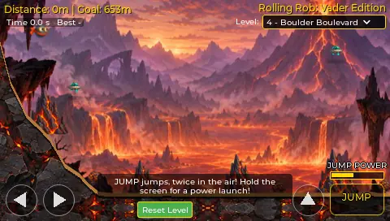
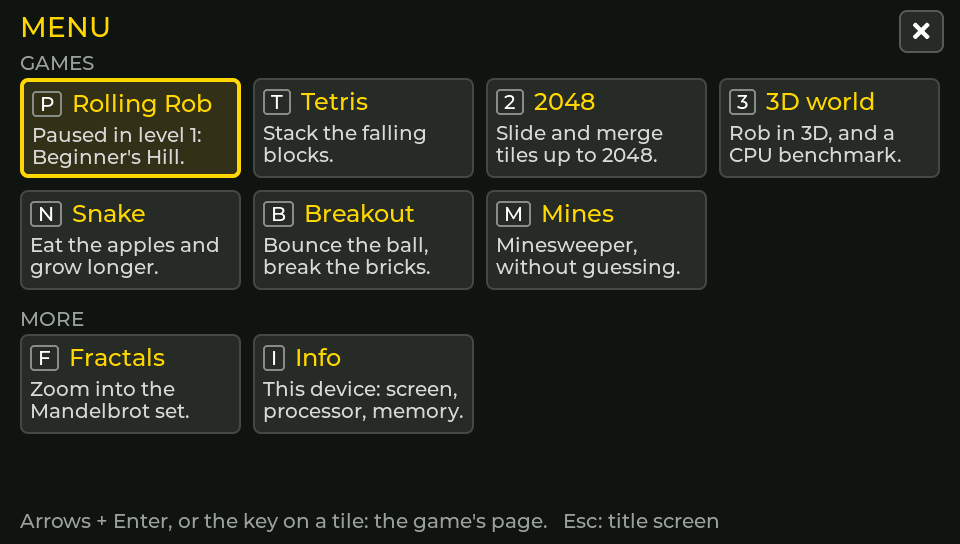
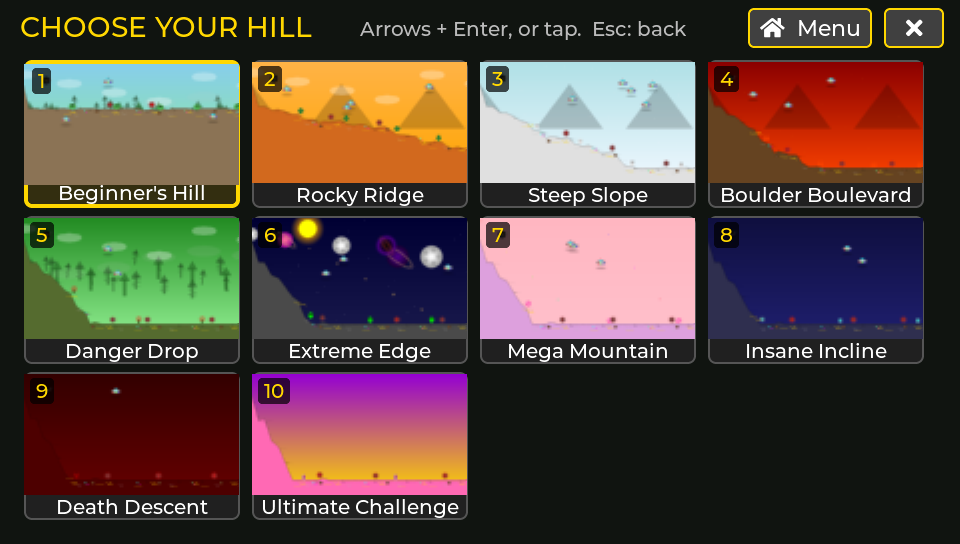
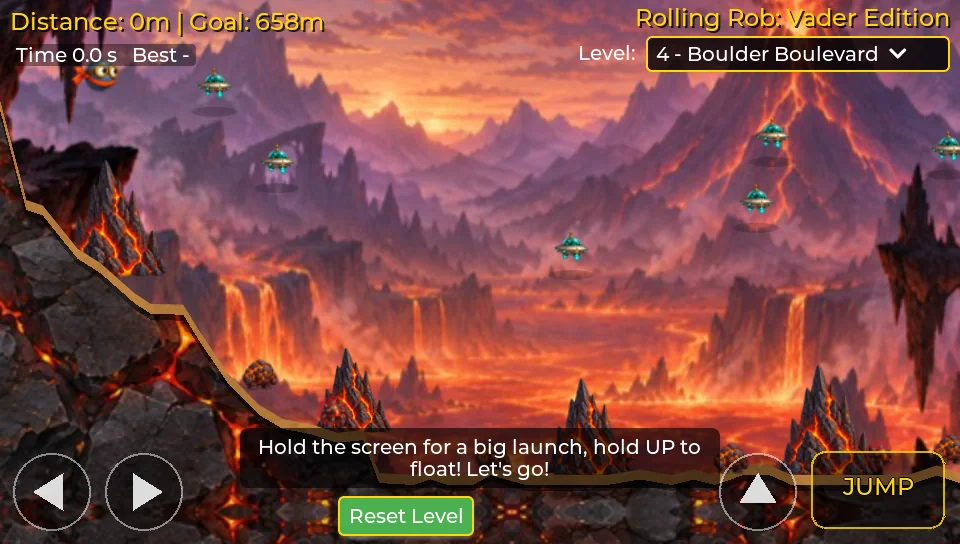

# Rolling Rob

A port of the original [Rolling Rob](https://vader.nl/rolling-rob.html) to C, with
LVGL and SDL2, plus a small app around it: Tetris, 2048, Snake, Breakout,
Minesweeper, fractals and a 3D world. It runs in the browser (WebAssembly) and
as a desktop program.

Play it at https://advies-ruit.github.io/rolling-rob/ -- it also installs as
an app and works offline.

  
  
  

## Level 11

Levels 1-10 are the original's. Level 11, Beyond the Summit, is a bonus
level of our own: it continues their curve (longer, steeper, more
obstacles) in the space theme at night. The run (the total time of levels
1-10 in a row) stays the original's ten levels. Its picker thumbnail comes
from `tools/level-thumb.py`. The picker shows each level in the look it is
played in: the painted thumbnails (all levels, `tools/level-thumb.py
--painted`) when the painted or rendered look is on, else the original ones.

Its painted look has pictures of its own (a starry sky, alien ground, a
glowing space plant and an alien). Should one of the four be missing or
unreadable, the level draws level 6's space set instead:

| File | Size | Format |
|---|---|---|
| `bg-10.jpg` | 560 x 373 | baseline JPEG (not progressive) |
| `tex-10.jpg` | 256 x 256 | baseline JPEG; the game mirrors it, so its edges should meet |
| `tree-10.png` | 105 x 105 | PNG with transparency |
| `enemy-10.png` | 33 x 33 | PNG with transparency |

A set that is missing or broken only affects its own level (`art_set()`
and `s_fallback[]` in `src/game/art.c`). The ground's lip colour for the
set is `s_accent[10]`, a teal that matches its plants.

## How it was made

A port of the original Rolling Rob (vader.nl) to C with LVGL, written with the
help of an AI coding assistant (Claude). The painted landscapes were generated
with an image model and the music with Suno; both were then prepared for the
game (resized, compressed, metadata removed). The web version is built from
this source by GitHub Actions.

## Building

    git clone --recursive <this repository>
    tools/build-web.sh                 # needs Emscripten; the site lands in build-web/web
    python3 -m http.server -d build-web/web

Desktop (SDL2 installed): `cmake -S . -B build && cmake --build build -j --target rolling_rob_sim`.

Every release also has the desktop program for players, built by GitHub
Actions (`.github/workflows/packages.yml`, also on every pull request,
where each package is started and the bot plays all levels with it):

| Download | For | |
|---|---|---|
| `Rolling-Rob-Windows-x64.zip` | Windows 10/11, x64 | unzip, start `RollingRob.exe` |
| `Rolling-Rob-macOS.zip` | macOS 11+, Apple silicon and Intel | unzip; not notarized, see below |
| `Rolling-Rob-Linux-x86_64.AppImage` | Linux, x86-64 | `chmod +x`, start |
| `Rolling-Rob-Linux-aarch64.AppImage` | Raspberry Pi (64-bit Raspberry Pi OS), Linux arm64 | `chmod +x`, start |
| `Rolling-Rob-Linux-armhf.AppImage` | Raspberry Pi 2, 3, 4, 5, Zero 2 with 32-bit Raspberry Pi OS (ARMv7) | `chmod +x`, start |
| `Rolling-Rob-Linux-<arch>.tar.gz` | the same three, for a system without FUSE or with only a framebuffer | unpack, start `Rolling-Rob/rolling-rob` |

SDL2, the art and the music are inside each one. The packaging is in
`tools/package-linux.sh`, `tools/package-windows.sh` and
`tools/package-macos.sh`.

The desktop program picks its resolution like the web page's Auto: as many
of the screen's own pixels as its window has -- 960x544 on a plain screen,
1920x1088 on a Retina Mac (it asks for the screen's own pixels, on Windows
at 125-150 % too). A Raspberry Pi stays lower: 480x272 on 32-bit, at most
960x544 on 64-bit, as its CPU draws every pixel. Rolling Rob's page in the
menu has "Resolution" (auto, or 480x272 up to 1920x1088), used from the next
start; `--scale 1..4` on the command line overrides it.

The macOS app is signed ad hoc but not notarized (that needs a paid Apple
developer account), so macOS refuses it the first time: choose "Done" (not
"Move to Trash"), then System Settings -> Privacy & Security -> "Open
Anyway", and open it again. Since macOS 15 a right-click -> Open no longer
does this. Or, in Terminal: `xattr -dr com.apple.quarantine "Rolling Rob.app"`.

The Linux AppImages are built in Debian 11 (`tools/build-linux.sh`), so
they need glibc 2.31 or newer: Debian 11+, Ubuntu 20.04+, Raspberry Pi OS 11
("Bullseye") and newer. `tools/check-glibc.sh` checks every file in them for
that, and the bot plays them in Debian 11. They use the static AppImage
runtime, so no libfuse is needed; where FUSE is missing altogether (no
`/dev/fuse`, "Cannot mount AppImage"), start one with
`--appimage-extract-and-run`. The 32-bit ARM one needs ARMv7 (not a
Raspberry Pi 1 or Zero).

They show the game on an X11 or Wayland desktop, or, without one
(Raspberry Pi OS Lite), with KMS/DRM (`/dev/dri`, with Mesa's libgbm and
EGL installed). On a Linux device with only a framebuffer (`/dev/fb0`, a
kernel without DRM) SDL has no screen; the program then draws straight
into the framebuffer (`src/platform/sim/fbdev_sim.c`): the largest picture
that fits, in the middle, every pixel opaque; keys from keyboards in
`/dev/input` (plugged in at any time), a touchscreen there as the pointer,
and the console in graphics mode while it runs. The user needs the groups
`video` and `input`. For such a device the tar.gz is the better download:
without FUSE an AppImage unpacks itself again at every start. With
neither a screen nor a framebuffer the program says so and stops.

On a framebuffer: `ROLLING_ROB_FBDEV=/dev/fb1` takes another one (and goes
straight to it), `ROLLING_ROB_ROTATE=180` turns the picture and the touch
round, `ROLLING_ROB_TOUCH_FLIP=1` only the touch; `--bot` lets the bot play
all levels where it can be watched. `tools/check-fbdev.sh` tests all this
in CI with a file as the framebuffer (`tests/fakefb.c`).

## Tests

The rules of the games (Tetris, 2048, Snake, Breakout, Minesweeper, the
fractals) have unit tests in `tests/`. They need neither LVGL nor SDL:

    cmake -S tests -B build-tests && cmake --build build-tests -j
    ctest --test-dir build-tests --output-on-failure

They also come along with the desktop build (`ctest --test-dir build`).
GitHub Actions (`.github/workflows/ci.yml`) runs them on every push and pull
request, with AddressSanitizer and UBSan, builds the desktop program on Linux
and lets the bot play all eleven levels without a window.

The site is built by GitHub Actions from this repository
(`.github/workflows/pages.yml`). Every tag `v*` becomes a release (the site as
a zip, with the SHA-256 of its files) and the site is published from all
releases: the newest at the top, each one also under `v/<tag>/`, so the
start screen can switch to an older version and back.

A version can be taken off the site: add its tag to `RETIRED` in
`tools/assemble-site.sh` (v1.2 is: v1.3 is the same game with a fix for
switching versions on iOS). Its folder then holds a farewell
(`web/retired/`): a page that sends to the newest version and forgets the
choice, and a service worker that removes the version from devices that
had it. The newest release is never retired.

Which build is running: the app's Info page shows the version (the
release tag), when it was built and its commit; the start screen shows the
version and the build time.

## Licences

- The game code: licence not chosen yet (until then all rights reserved).
- The art (`art/`) and the music (`music/`): all rights reserved.
- LVGL (`third_party/lvgl`): MIT. miniaudio: public domain / MIT-0. SDL2
  (through Emscripten or the system): zlib. The Montserrat font in LVGL: OFL.
